# GeoCam

App móvil (Expo SDK 57 + Expo Router + TypeScript) para **capturar fotos geolocalizadas**,
etiquetarlas con las coordenadas del dispositivo, organizarlas en la biblioteca y verlas en un mapa.

---

## Semana 6 – GeoCam

### Objetivo

Construir una app de cámara que registre **dónde** se tomó cada foto, con tres estados de permiso
bien diferenciados, seguimiento de GPS en primer plano y detección de sacudidas con el
acelerómetro.

### Qué incluye

| Pantalla | Ruta | Qué hace |
| --- | --- | --- |
| Inicio | `src/app/(tabs)/index.tsx` | Presentación de la app, contador de fotos en tiempo real y accesos principales. No pide ningún permiso. |
| GeoCam | `src/app/(tabs)/geocam.tsx` | Vista de cámara a pantalla completa, coordenadas en vivo, botón de galería, cambio de cámara frontal/trasera y detección de sacudidas. |
| Mapa | `src/app/(tabs)/mapa.tsx` | `MapView` con un `Marker` por foto geolocalizada y `Callout` con miniatura. Lista aparte de las fotos **sin coordenadas**. |
| Mapa (web) | `src/app/(tabs)/mapa.web.tsx` | Sustituye a `mapa.tsx` en web, donde `react-native-maps` no existe. Muestra todas las fotos en dos grupos (*En el mapa* / *Sin ubicación*) con sus coordenadas. |

Las cuatro pestañas viven en el grupo `(tabs)`.

### Sistema de diseño

Todo el aspecto visual sale de `src/constants/theme.ts`; ninguna pantalla define colores,
espaciados ni radios sueltos.

| Bloque | Qué aporta |
| --- | --- |
| `Colors` | `text`, `background`, `backgroundElement`, `backgroundSelected` y `textSecondary`, en variante clara y oscura. |
| `Surfaces` | `border` y dos sombras (`shadow`, `shadowStrong`). `useTheme()` las fusiona con `Colors`, de modo que `theme.border` y `theme.shadow` están disponibles junto a `theme.text`. |
| `Brand` | Identidad, independiente del tema: azul `#208AEF` (`primary`, `primaryLight`, `primaryDeep`, `primarySoft`), verde azulado del mapa (`map`, `mapSoft`), `danger`, `onBrand` y los tonos para overlays oscuros. |
| `Spacing` · `Radii` · `Layout` | Escala de espaciado en múltiplos de 4, radios (`sm`…`pill`) y medidas de maquetación (`contentMaxWidth`, `gutter`, `minTouch`). |
| `Night` | Superficies de la pantalla de Inicio, que es **siempre oscura**: `backdrop`, `fill`, `fillStrong`, `border`, `contour` y `contourAccent`. No dependen del tema del sistema. |

Reglas que siguen las pantallas:

- **Todo control táctil es un `Pressable`** (no `TouchableOpacity`) y recibe
  `accessibilityRole="button"`, una etiqueta y una altura mínima de `Layout.minTouch` (44 pt).
- **Un solo criterio tipográfico**, `ThemedText`, con variantes `hero`, `cardTitle`, `title`,
  `subtitle`, `default`, `small`, `smallBold`, `label` y `code`. Las variantes de color son
  explícitas (`themeColor="textSecondary"`) y, sobre superficies oscuras, se usa
  `tone="onDark"` / `tone="onDarkMuted"`, que toma el color de la marca en vez del del tema.
- **Iconos con `expo-symbols`**, sin dependencias nuevas: SF Symbols en iOS y Material Symbols en
  Android y web. Los nombres válidos están centralizados en `src/constants/icons.ts`.
- **Anchos máximos** (`Layout.contentMaxWidth`) y `useWindowDimensions` para que tablet y
  escritorio no estiren la interfaz; el `padding` lateral es siempre `Layout.gutter`.
- **Safe areas** con `useSafeAreaInsets().top` / `.bottom` en lugar de constantes fijas.

### Pantalla de Inicio: fondo topográfico

El fondo de Inicio es negro con curvas de nivel y **no depende del tema del sistema**: se ve igual en
modo claro y en modo oscuro. `src/components/TopographicBackdrop.tsx` lo dibuja entero con `View`s
—cada colina es una serie de elipses concéntricas con borde de 1 px, desplazadas e inclinadas para
que el conjunto parezca un relieve y no un blanco y negro— sin imágenes, sin SVG y sin ninguna
dependencia nueva. Las medidas salen de `useWindowDimensions`, así que el mapa se adapta a tablet y
horizontal sin tocar el código.

### Rotación

`app.json` declara `"orientation": "default"`, de modo que la app **sí gira** con el dispositivo.
Todas las pantallas lo soportan: usan `useWindowDimensions` y safe areas, no medidas fijas.

### Identidad

El logotipo está construido con `View`s en `src/components/GeoCamLogo.tsx` (un pin de mapa cuya
cabeza es la lente de la cámara) y se reutiliza en Inicio, en la cabecera de web y como icono
adaptativo. Los PNG de `assets/images/` (`icon`, `favicon`, `splash-icon`,
`android-icon-*`) se generan a partir del mismo diseño.

### Hooks entregados

| Hook | Responsabilidad |
| --- | --- |
| `src/hooks/useCamera.ts` | `CameraView` + `useCameraPermissions`, referencia tipada, `isReady`, `isCapturing` (bloquea dobles capturas), `takePictureAsync`, cambio de cámara y `openSettings()`. |
| `src/hooks/useGeoLocation.ts` | Consulta el permiso sin pedirlo, `requestForegroundPermissionsAsync` bajo demanda, `getCurrentPositionAsync`, `watchPositionAsync` con cleanup, error como estado y `openSettings()`. `refresh()` **reutiliza el fix del watch si es reciente** y, si la petición puntual falla, devuelve el último fix conocido en vez de mostrar un error. |
| `src/hooks/useShake.ts` | `Accelerometer.isAvailableAsync`, `setUpdateInterval(100)`, magnitud del vector, umbral 13 m/s², cooldown de 1200 ms, `Subscription.remove()` y flag `enabled` para apagar la escucha al perder el foco. |

### Ciclo de permisos (5 estados)

Expo solo devuelve tres valores en `PermissionResponse.status`
(`granted` | `undetermined` | `denied`). `src/utils/permissions.ts` añade el desdoblamiento que
necesita la UI:

| Estado de UI | Cuándo ocurre | Qué hace el usuario | Botón |
| --- | --- | --- | --- |
| `checking` | La consulta del permiso aún no ha respondido | Espera | — |
| `undetermined` | Nadie ha decidido todavía (`status === 'undetermined'`) | Decide en el diálogo del sistema | *Permitir cámara* / *Volver a pedir* |
| `denied` | Rechazó el permiso y el sistema permite preguntar otra vez (`status === 'denied'`, `canAskAgain === true`) | Decide en el diálogo del sistema | *Volver a pedir* |
| `blocked` | El sistema ya no permite preguntar (`canAskAgain === false`) | Debe cambiarlo en Ajustes | **Abrir Ajustes** |
| `granted` | Concedido | Usa la app | — |

Reglas que se cumplen:

- **Ningún permiso se pide al abrir la app.** Al montar solo se *consulta* el estado
  (`getForegroundPermissionsAsync` / `useCameraPermissions`); la solicitud ocurre únicamente al
  pulsar un botón.
- **Negar la ubicación no bloquea la cámara.** Si `getCurrentPositionAsync` falla, la foto se
  registra igual con `coords: null`, la pantalla de cámara sigue operativa y el mapa la muestra
  en la sección *Sin ubicación*. Además, un banner en la cámara comunica que la ubicación está
  desactivada.
- **"Abrir Ajustes"** llama a `Linking.openSettings()` y existe en ambos hooks, tanto para cámara
  como para ubicación, cuando el permiso queda bloqueado.

### Capturas de pantalla de la Semana 6

Todas las imágenes están en `assets/capturas/` y se tomaron en un iPhone con un development build.

#### Galería Semana 6

<table>
  <tr>
    <td align="center" width="300">
      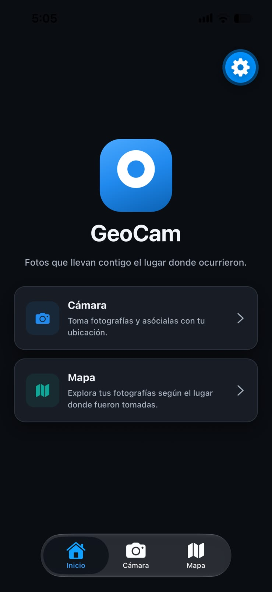<br>
      <sub><b>01</b> · Inicio con fondo topográfico</sub>
    </td>
    <td align="center" width="300">
      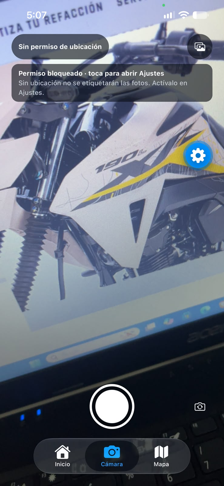<br>
      <sub><b>02</b> · Cámara con latitud/longitud en vivo</sub>
    </td>
    <td align="center" width="300">
      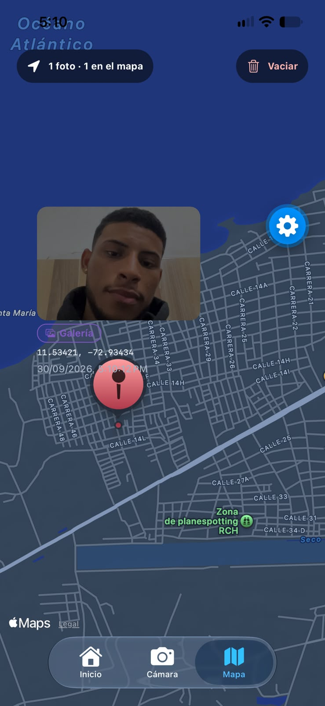<br>
      <sub><b>03</b> · Mapa con marcadores y Callout</sub>
    </td>
  </tr>
  <tr>
    <td align="center" width="300">
      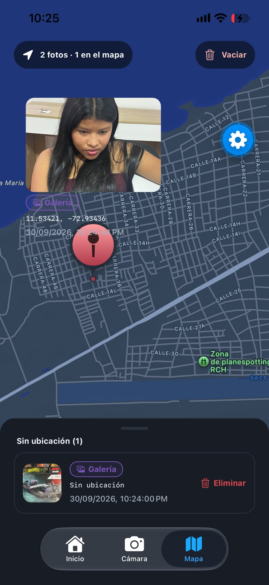<br>
      <sub><b>04</b> · Fotos sin ubicación</sub>
    </td>
    <td align="center" width="300">
      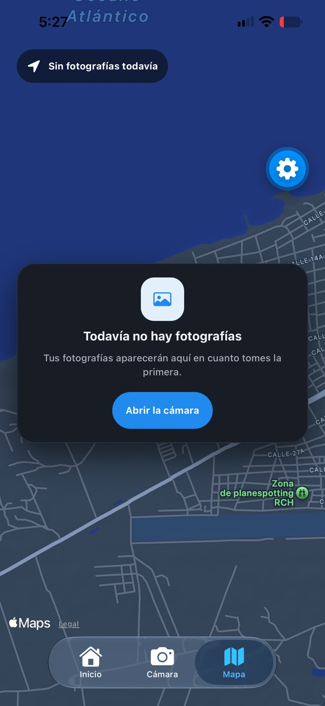<br>
      <sub><b>05</b> · Estado vacío del mapa</sub>
    </td>
    <td align="center" width="300">
      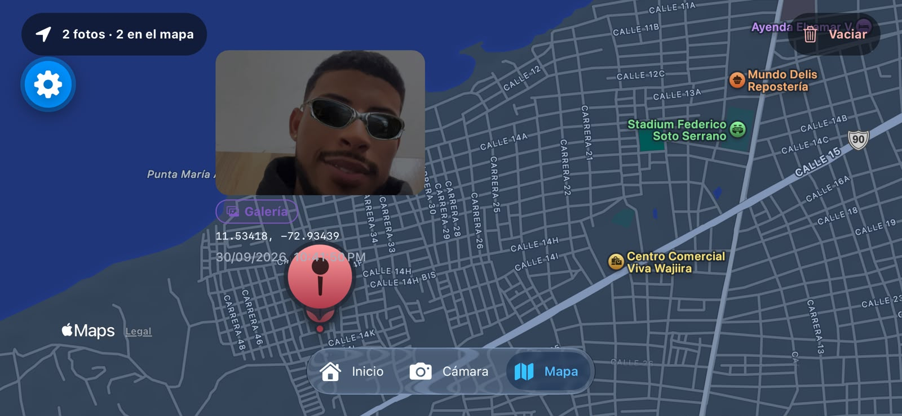<br>
      <sub><b>06</b> · Vista horizontal</sub>
    </td>
  </tr>
  <tr>
    <td align="center" width="300">
      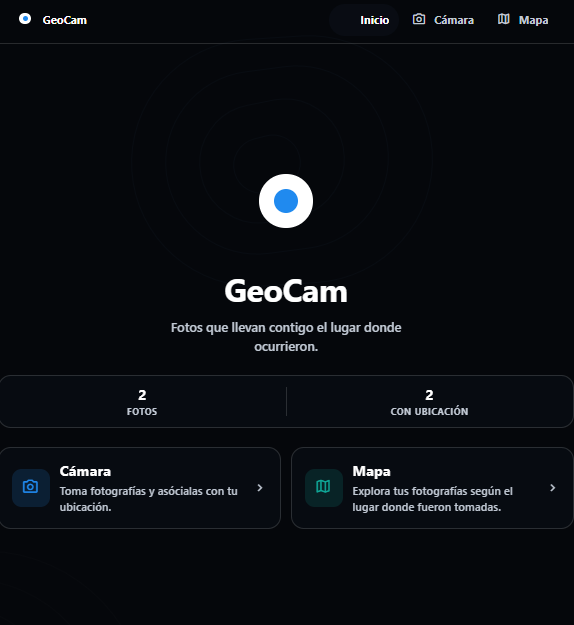<br>
      <sub><b>07</b> · Versión web</sub>
    </td>
    <td align="center" width="300">
      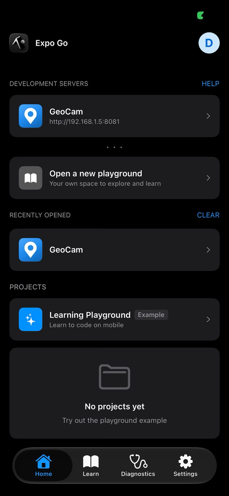<br>
      <sub><b>08</b> · Icono de la app</sub>
    </td>
    <td align="center" width="300">
      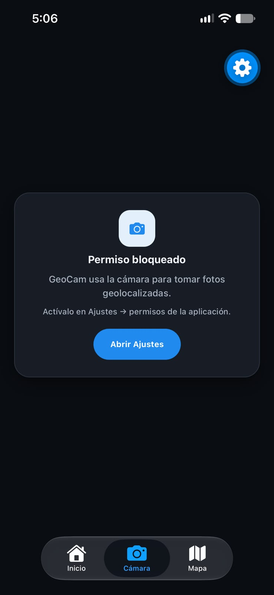<br>
      <sub><b>09</b> · Permiso concedido</sub>
    </td>
  </tr>
</table>

### Evidencias de permisos (Semana 6)

#### 1. Permiso concedido

**Qué debe verse:** La vista de cámara funcionando a pantalla completa con el chip de coordenadas en tiempo real (`latitud`/`longitud`) en la parte superior.

<div align="center">
  
</div>


---

## Semana 7 — GeoCam persistente

### Objetivo

Reemplazar el contexto en memoria de la Semana 6 por **SQLite con Drizzle ORM**, de modo que las fotografías, sus coordenadas, álbumes y notas sobrevivan al cierre de la app y funcionen sin conexión (modo avión).

### Modelo de datos

```text
albums
  id PK · name UNIQUE · created_at
       1
       │ album_id (nullable, ON DELETE SET NULL)
       *
photos
  id PK · uri · latitude? · longitude? · accuracy? · source · created_at
  note? · favorite (boolean, default false)
  (índice: photos_created_at_idx en created_at)
```

### Novedades y Funcionalidades de la Semana 7

1. **Base de Datos Persistente con Expo SQLite y Drizzle ORM**:
   - `db/client.ts`: Configurado con `openDatabaseSync('geocam.db', { enableChangeListener: true })` y `PRAGMA foreign_keys = ON;`.
   - Layout raíz (`src/app/_layout.tsx`) protegido con `useMigrations`.

2. **Tres Migraciones SQL Versionadas (`drizzle/`)**:
   - `0000_photos-and-albums.sql`: Tablas `photos`, `albums` y relación `album_id` con `ON DELETE SET NULL`.
   - `0001_photo-notes-and-favorites.sql`: Columnas `note` (texto opcional) y `favorite` (booleano default false).
   - `0002_chemical_cargill.sql`: Índice `photos_created_at_idx` sobre `created_at` (Reto opcional).

3. **Pestaña Biblioteca (`src/app/(tabs)/biblioteca.tsx`)**:
   - Nueva pestaña en la navegación para explorar toda la colección con contador y renderizado optimizado.

4. **Buscador Centrado y Burbuja Flotante (`src/components/PhotoFilters.tsx`)**:
   - Burbuja flotante compacta con icono de lupita sobre el mapa.
   - Al presionar la burbuja se abre un **Modal centrado** con la búsqueda por nota, filtro por álbumes, favoritas y creación de álbumes.

5. **CRUD Completo de Fotografías (`src/app/foto/[id].tsx`)**:
   - Pantalla de detalle para visualizar la foto, editar su nota, marcarla como favorita, moverla de álbum y eliminarla con confirmación.

6. **Archivos Permanentes (`src/services/photoFiles.ts`)**:
   - Copia imágenes desde la caché a `Paths.document/photos/` usando las clases modernas `File`, `Directory` y `Paths` de `expo-file-system`.
   - Borra el archivo físico del disco cuando se elimina el registro en SQLite.

7. **Reto Opcional (Rendimiento)**:
   - Script de benchmark en `src/utils/benchmark.ts` para sembrar e insertar 1.000 fotos de prueba y medir con `console.time` el listado optimizado por el índice `photos_created_at_idx`.

---

### Galería de Capturas (Semana 7)

<table>
  <tr>
    <td align="center" width="300">
      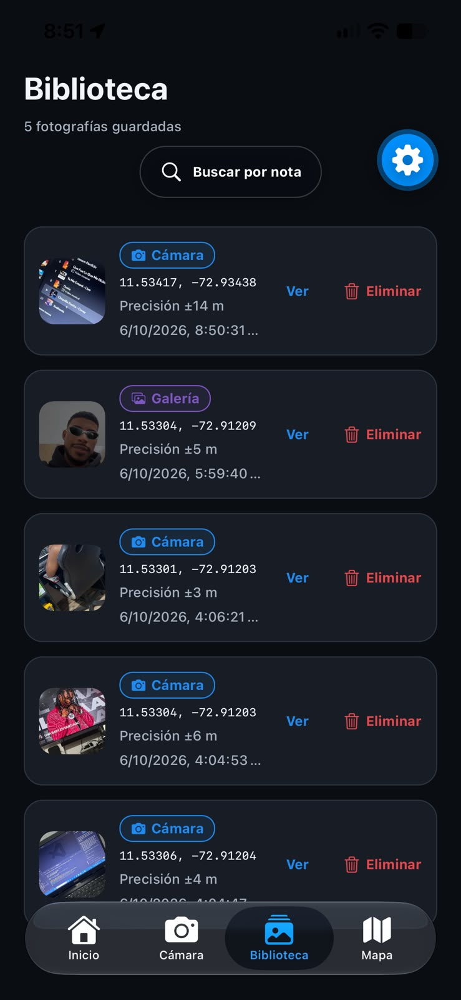<br>
      <sub><b>09</b> · Pestaña Biblioteca</sub>
    </td>
    <td align="center" width="300">
      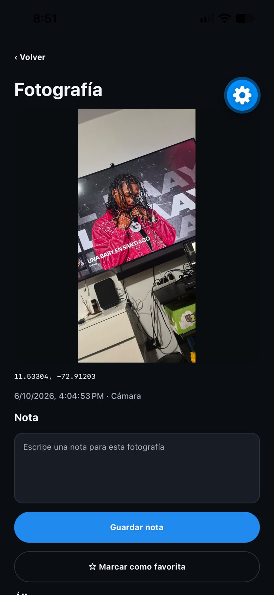<br>
      <sub><b>10</b> · Detalle CRUD de Foto</sub>
    </td>
    <td align="center" width="300">
      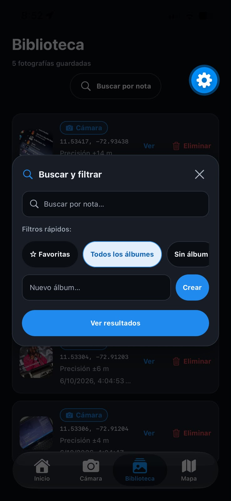<br>
      <sub><b>11</b> · Menú de búsqueda centrado</sub>
    </td>
  </tr>
  <tr>
    <td align="center" width="300">
      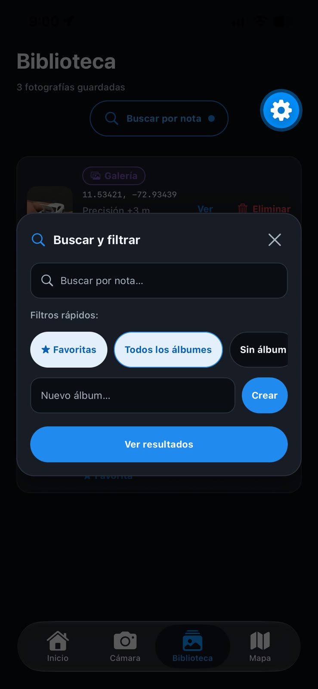<br>
      <sub><b>12</b> · Filtro por favoritas y álbumes</sub>
    </td>
    <td align="center" width="300">
      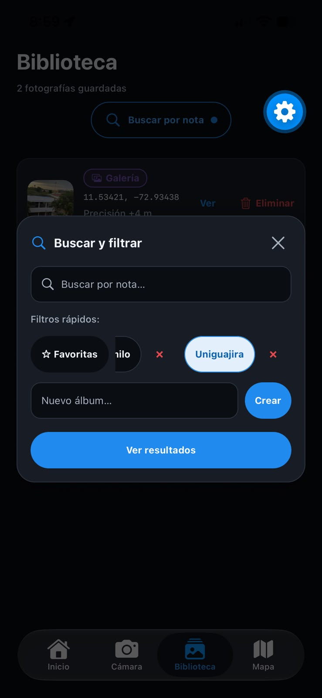<br>
      <sub><b>13</b> · Creación de nuevo álbum</sub>
    </td>
  </tr>
</table>

---

### Demostración animada del flujo CRUD y Persistencia

<div align="center">
  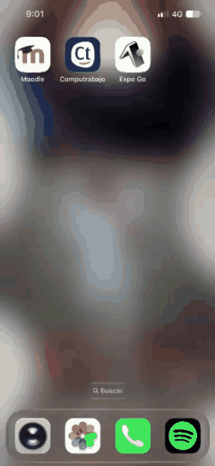<br>
  <sub><b>Demostración en vivo</b> · Persistencia SQLite, CRUD, Filtros y Modo Avión</sub>
</div>

<br>

🎬 **[Ver o descargar video original en MP4 con mayor definición (demostracion-flujo.mp4)](./assets/capturas/demostracion-flujo.mp4)**

**Demostración del flujo:**
1. Toma de fotografías geolocalizadas con la cámara.
2. Edición de notas, marcado como favorita y asignación a un álbum en la pantalla de detalle.
3. Apertura del menú centrado desde la burbuja flotante de la lupita y filtrado por nota.
4. Cierre completo de la app / Expo Go y reapertura comprobando que las fotos y sus coordenadas persisten en SQLite.
5. Verificación en modo avión.

---

## Semana 8 — Backend as a Service con Supabase (Nube y Sincronización)

### Objetivo

Conectar GeoCam a un **Backend as a Service (BaaS)** mediante **Supabase**: registro e inicio de sesión con correo y contraseña, almacenamiento seguro de sesión en el dispositivo (`expo-secure-store`), base de datos remota protegida con **Row Level Security (RLS)** en PostgreSQL, almacenamiento de imágenes en un bucket privado de **Supabase Storage** y sincronización en tiempo real con WebSockets (`supabase_realtime`), manteniendo SQLite local como fuente de verdad offline-first.

---

### Diagrama de Arquitectura Híbrida (Local vs Nube)

```text
┌──────────────────────────────────────────────────────────────┐
│                    DISPOSITIVO MÓVIL                         │
│                                                              │
│  ┌─────────────────────────┐     ┌────────────────────────┐  │
│  │   expo-secure-store     │     │     SQLite + Drizzle   │  │
│  │  (Sesión JWT fragmentada│     │  (Fuente de verdad     │  │
│  │   en chunks de 1000 ch) │     │   local por ownerId)   │  │
│  └────────────▲────────────┘     └───────────▲────────────┘  │
│               │ (Token JWT)                  │ (Offline-first)│
│  ┌────────────┴──────────────────────────────┴────────────┐  │
│  │               GeoCam App (Expo Router)                 │  │
│  │       Stack.Protected (guard={!!user})                 │  │
│  └───────┬───────────────────────────────┬────────────────┘  │
└──────────┼───────────────────────────────┼───────────────────┘
           │ (HTTPS / Realtime WebSockets) │ (ArrayBuffer Upload)
           ▼                               ▼
┌──────────────────────────────────────────────────────────────┐
│                  SUPABASE (BaaS en la nube)                  │
│                                                              │
│  ┌────────────────────────┐      ┌────────────────────────┐  │
│  │     Supabase Auth      │      │    Supabase Storage    │  │
│  │ (Usuarios y Tokens JWT)│      │  Bucket privado geocam │  │
│  └───────────┬────────────┘      │  /<userId>/<id>.jpg    │  │
│              │ (auth.uid())      └───────────▲────────────┘  │
│              ▼                               │ (Storage RLS)  │
│  ┌───────────────────────────────────────────┴────────────┐  │
│  │ PostgreSQL Remoto (Tabla public.photos)                 │  │
│  │ Políticas RLS: auth.uid() = user_id                    │  │
│  │ Publicación en tiempo real (supabase_realtime)         │  │
│  └────────────────────────────────────────────────────────┘  │
└──────────────────────────────────────────────────────────────┘
```

---

### Novedades y Funcionalidades de la Semana 8

1. **Autenticación con Supabase Auth y Rutas Protegidas (`app/_layout.tsx`, `app/login.tsx`)**:
   - Registro e inicio de sesión con correo y contraseña usando `@supabase/supabase-js`.
   - Rutas privadas (`(tabs)` y `foto/[id]`) protegidas con `<Stack.Protected guard={!!user}>`.
   - Navegación automática y reactiva al iniciar o cerrar sesión sin necesidad de `router.replace` manual.

2. **Almacenamiento Seguro de Sesión en Fragmentos (`src/lib/secureStorage.ts`)**:
   - Adaptador sobre `expo-secure-store` que fragmenta tokens de sesión en trozos de 1000 caracteres, superando el límite histórico de ~2048 bytes del Keychain en iOS.

3. **Migración 0003 en SQLite (`drizzle/0003_curly_beyonder.sql`)**:
   - `client_id`: UUID único persistente generado en el dispositivo para vincular la foto local con su fila remota.
   - `updated_at`: Marca de tiempo de última edición de la foto (nota, favorito o álbum).
   - `remote_path`: Ruta del archivo en el bucket `geocam` de Supabase Storage.
   - `synced_at`: Fecha y hora de la última sincronización en la nube.
   - `owner_id`: Identificador del usuario autenticado para separar fotos locales en dispositivos multi-usuario (Tarea C5).
   - Función `ensureSyncFields()` para rellenar fotos históricas al iniciar la app.

4. **Subida Idempotente y Limpieza de Huérfanos (`src/services/cloudPhotos.ts` - Tareas T5 y C2)**:
   - Sube la imagen a `geocam/<userId>/<clientId>.jpg` como `ArrayBuffer`, previniendo archivos corruptos de 0 bytes en React Native.
   - Inserta los metadatos en PostgreSQL usando `client_id` con cláusula `upsert` (evita duplicados si se reintenta).
   - Si la inserción en la base de datos remota falla, **se elimina inmediatamente el archivo del bucket** para evitar huérfanos.

5. **Sincronización por Lotes con Progreso (`src/app/(tabs)/biblioteca.tsx` - Tarea C1)**:
   - Botón *"☁️ Sincronizar pendientes con Supabase"* que recorre todas las fotos con `syncedAt` nulo o anterior a `updatedAt`.
   - Muestra indicador de avance dinámico (`"Sincronizando 3 de 7…"`).
   - Si una fotografía individual falla, el proceso continúa con las demás y reporta el balance al finalizar.

6. **Borrado Coherente Local y Remoto (Tarea C3)**:
   - Al eliminar una foto sincronizada, se eliminan en cascada su archivo en Supabase Storage, su fila en PostgreSQL y el registro/archivo físico local.
   - Sin conexión a internet, la app avisa y aborta la operación para evitar estados desincronizados a medias.

7. **Pestaña Nube en Tiempo Real (`src/app/(tabs)/nube.tsx` - Tarea C4)**:
   - Nueva pestaña que consulta las fotos del usuario en Supabase mediante imágenes con URL firmadas (`createSignedUrl`) y listener reactivo `postgres_changes`.
   - Permite visualizar las fotos cargadas en la nube desde cualquier dispositivo donde el usuario inicie sesión.

8. **Datos Locales Aislados por Usuario (`ownerId` - Tarea C5)**:
   - Las consultas locales de SQLite se filtran por `photos.ownerId == user.id`. Al cambiar de cuenta en el mismo celular, no se mezclan las fotos del usuario anterior.

---

### Galería de Capturas y Evidencias (Semana 8)

<table>
  <tr>
    <td align="center" width="300">
      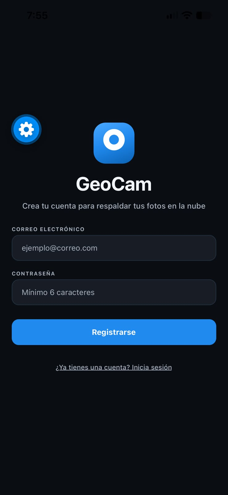<br>
      <sub><b>14</b> · Registro con Supabase Auth</sub>
    </td>
    <td align="center" width="300">
      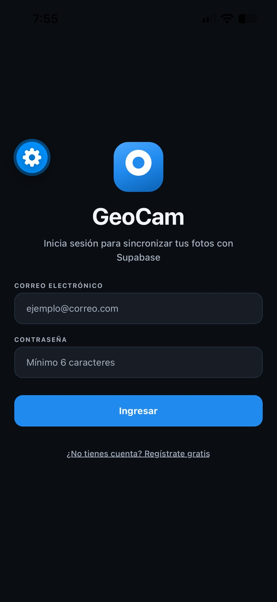<br>
      <sub><b>15</b> · Inicio de sesión seguro</sub>
    </td>
    <td align="center" width="300">
      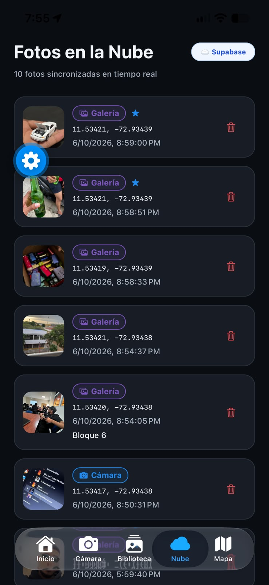<br>
      <sub><b>16</b> · Pestaña Nube en tiempo real</sub>
    </td>
  </tr>
  <tr>
    <td align="center" width="300">
      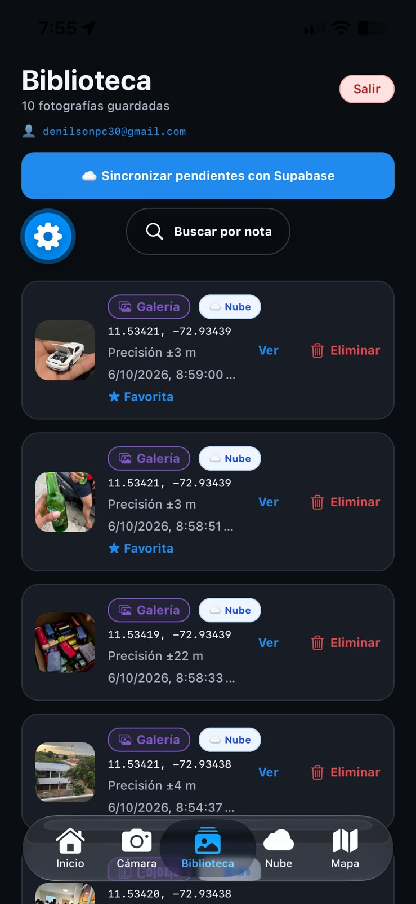<br>
      <sub><b>17</b> · Sincronización por lotes en Biblioteca</sub>
    </td>
    <td align="center" width="300">
      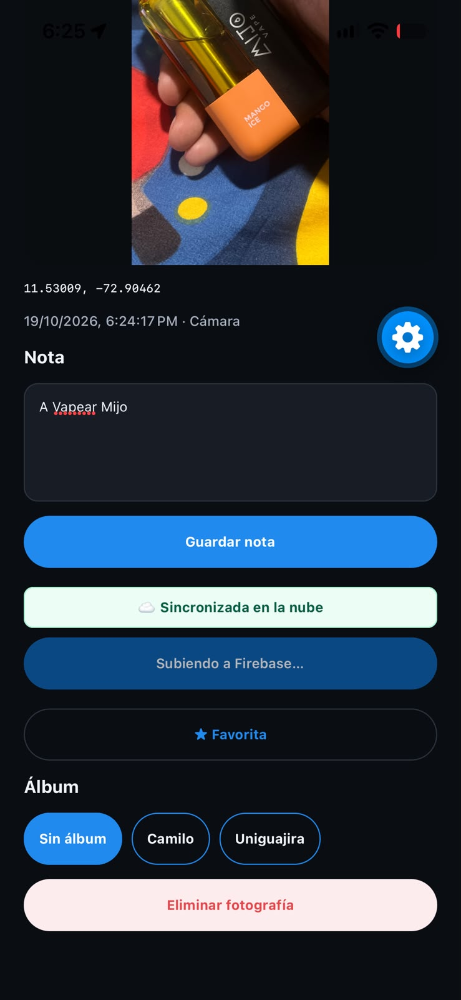<br>
      <sub><b>18</b> · Subida e indicador de progreso</sub>
    </td>
    <td align="center" width="300">
      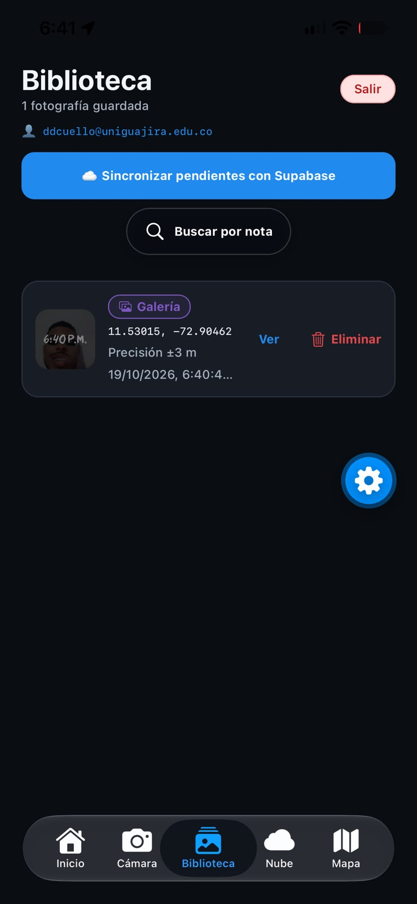<br>
      <sub><b>19</b> · Aislamiento multi-usuario (cuenta nueva)</sub>
    </td>
  </tr>
  <tr>
    <td align="center" colspan="3">
      <br>
      <sub><b>20</b> · Consola de Supabase: Tabla PostgreSQL con RLS y Storage privado</sub>
    </td>
  </tr>
</table>

---

### SQL Completo de Tablas y Políticas RLS (`supabase.sql`)

```sql
-- 1. Tabla remota 'photos'
create table public.photos (
  id bigint generated always as identity primary key,
  user_id uuid not null default auth.uid() references auth.users (id) on delete cascade,
  client_id text not null unique,        -- UUID creado en el teléfono
  storage_path text not null unique,     -- Ruta en el bucket
  latitude double precision,
  longitude double precision,
  accuracy double precision,
  note text,
  favorite boolean not null default false,
  source text not null check (source in ('camera', 'gallery')),
  taken_at timestamptz not null,
  updated_at timestamptz not null,       -- Última modificación hecha por el usuario
  created_at timestamptz not null default now()
);

-- 2. Habilitar RLS en 'photos'
alter table public.photos enable row level security;

create policy "ver las mías" on public.photos
  for select to authenticated using ((select auth.uid()) = user_id);

create policy "crear las mías" on public.photos
  for insert to authenticated with check ((select auth.uid()) = user_id);

create policy "actualizar las mías" on public.photos
  for update to authenticated using ((select auth.uid()) = user_id);

create policy "borrar las mías" on public.photos
  for delete to authenticated using ((select auth.uid()) = user_id);

-- 3. Publicación en tiempo real (Supabase Realtime)
alter publication supabase_realtime add table public.photos;

-- 4. Bucket privado 'geocam'
insert into storage.buckets (id, name, public) values ('geocam', 'geocam', false);

-- 5. Políticas de seguridad en storage.objects
create policy "subir a mi carpeta" on storage.objects
  for insert to authenticated
  with check (
    bucket_id = 'geocam' and (storage.foldername(name))[1] = (select auth.uid()::text)
  );

create policy "leer mi carpeta" on storage.objects
  for select to authenticated
  using (
    bucket_id = 'geocam' and (storage.foldername(name))[1] = (select auth.uid()::text)
  );

create policy "borrar de mi carpeta" on storage.objects
  for delete to authenticated
  using (
    bucket_id = 'geocam' and (storage.foldername(name))[1] = (select auth.uid()::text)
  );
```

---

### Auditoría de Credenciales (Tarea C6)

1. **`.env` fuera del historial de Git**:
   ```bash
   git log --all --full-history -- .env
   # Resultado: Salida vacía (0 resultados). .env jamás ha entrado a un commit.
   ```
2. **`.env` ignorado**: Declarado en `.gitignore`.
3. **`.env.example` versionado**: Plantilla con `EXPO_PUBLIC_SUPABASE_URL` y `EXPO_PUBLIC_SUPABASE_PUBLISHABLE_KEY` sin valores sensibles.
4. **Cero secret keys en el código**: Únicamente se emplean variables públicas (`EXPO_PUBLIC_`). La seguridad recae 100% en Row Level Security (RLS) dentro de PostgreSQL y Storage.

---

## Semana 9 — TanStack Query y Sincronización Offline-First

### Objetivo

Unir la persistencia local de la **Semana 7** (SQLite + Drizzle) con la nube de la **Semana 8** (Supabase):
la aplicación trabaja normalmente sin conexión a internet y, al recuperar la red o volver a primer plano, sube automáticamente lo pendiente y descarga lo nuevo hasta quedar 100% sincronizada. **TanStack Query** es el motor que ejecuta, reintenta y dispara la sincronización.

---

### Diagrama del Ciclo de Sincronización Bidireccional

```text
┌────────────────────────────────────────────────────────────────────────┐
│                        CICLO DE SINCRONIZACIÓN                         │
│                                                                        │
│   1. BAJAR (PULL)                                                      │
│      Pedir a Supabase filas con server_updated_at > cursor local       │
│      ├── Foto no existe en local    → Descarga binaria + Insert SQLite │
│      ├── Versión remota más nueva   → Actualiza local (remoteWins)     │
│      ├── Foto con deleted_at remoto → Borra archivo local + softDelete │
│      └── Versión local más nueva    → No se toca (se sube en paso 2)   │
│      Avanza cursor lastPulledAt:${userId} fila por fila                │
│                                                                        │
│   2. SUBIR (PUSH)                                                      │
│      Enviar fotos pendientes (syncedAt nulo o < updatedAt)             │
│      ├── Foto con deletedAt local   → Elimina en Storage + upsert mark │
│      ├── Archivo nuevo              → Sube ArrayBuffer a Storage       │
│      ├── upsert por client_id       → Idempotente: nunca duplica filas │
│      └── Marca syncedAt = updatedAt → La versión exacta subida         │
│      Tolerancia a fallos: Si una falla, las demás continúan (C5)       │
└────────────────────────────────────────────────────────────────────────┘
```

---

### Novedades y Funcionalidades de la Semana 9

1. **Backend y Cursor de Servidor (`supabase_semana9.sql` - Tarea T1)**:
   - Columna `server_updated_at timestamptz not null default now()` gestionada mediante trigger en PostgreSQL para garantizar un cursor de bajada confiable independiente del reloj del cliente.
   - Índice `photos_user_server_updated_idx` sobre `(user_id, server_updated_at)` para consultas veloces.
   - Política RLS de `update` para permitir `upsert` seguro por `client_id`.

2. **Detección de Red y Foco con TanStack Query (`src/lib/queryClient.ts` - Tarea T2)**:
   - `onlineManager` configurado con `expo-network` para pausar consultas sin conexión y reanudarlas al instante.
   - `useAppFocusManager` configurado con `AppState` para refrescar al volver a primer plano.
   - Reintentos automáticos ante error con espera exponencial (`retry: 2`).

3. **Soporte Local y Cursor Persistente (`db/schema.ts`, `db/repositories/syncMeta.ts` - Tarea T3)**:
   - Tabla SQLite `sync_meta` para persistir el cursor `lastPulledAt:${userId}` entre reinicios de la aplicación.
   - Repositorio `photosRepo` ampliado con `pendingQuery`, `listPending`, `findByClientId`, `insertFromRemote`, `applyRemote` y `markSynced`.

4. **Sincronización Bidireccional Idempotente (`src/services/sync.ts` - Tareas T4 y T5)**:
   - Bajar primero y subir después: evita que un cambio local desactualizado sobreescriba una versión remota más reciente.
   - Subida protegida por `client_id`: repetir la sincronización no crea duplicados en PostgreSQL ni en Storage.
   - Tolerancia a errores individuales por fotografía (**Tarea C5**).

5. **Disparo Automático e Indicador Visual (`src/hooks/useSync.ts`, `src/components/SyncBadge.tsx` - Tarea T6)**:
   - Se dispara al iniciar sesión, al recuperar la red, al volver a primer plano y tras cada cambio local (`addPhoto`, `updatePhoto`, `removePhoto`).
   - `SyncBadge` interactivo visible en la Cámara (`geocam.tsx`) y en la Biblioteca (`biblioteca.tsx`), con estados: *Al día* (🟢), *Sincronizando…* (🔵), *N pendientes* (🟡), *Sin conexión* (🟠) y *Error* (🔴).

6. **Borrados Lógicos Sincronizados (Tarea C1)**:
   - Columna `deleted_at` en Supabase y `deletedAt` en SQLite.
   - Eliminar una foto en cualquier teléfono marca la fecha de borrado y se propaga limpiamente a los demás dispositivos sin romper la integridad referencial.

7. **Feed Paginado de la Nube con Infinite Scroll (`src/app/(tabs)/nube.tsx` - Tarea C2)**:
   - Implementado con `useInfiniteQuery`, cursor por `created_at`, búsqueda en vivo con debounce (`useDebouncedValue`), y los 4 estados de UI (carga inicial, error con reintento, vacío y sin conexión).

8. **Caché que Sobrevive al Cierre (Tarea C3)**:
   - Persistencia de la caché de TanStack Query en almacenamiento local (`@react-native-async-storage/async-storage`) mediante `PersistQueryClientProvider`.

9. **Panel de Estado de Sincronización en Biblioteca (`src/app/(tabs)/biblioteca.tsx` - Tarea C4)**:
   - Muestra fotos pendientes, hora del último ciclo, balance de fotos subidas/bajadas y botón manual *"Sincronizar ahora"*.

---

### Regla de Resolución de Conflictos y Reto Opcional

* **Regla base:** *"Gana el último cambio"* (`remoteWins`). La versión con `updatedAt` más reciente prevalece.
* **Reto Opcional (Fusión de notas):**
  Si dos dispositivos editan la nota de la misma fotografía mientras están sin conexión, en lugar de descartar la edición más antigua, la función `mergeNotesOnConflict` preserva ambos textos:
  ```text
  [Nota más reciente]:
  Hermosa tarde en el mirador.

  [Nota previa conservada]:
  Atardecer despejado con viento suave.
  ```
  * **¿Cuándo es mejor esta regla?** En notas colaborativas, descripciones de campo o bitácoras donde perder información humana escrita es crítico.
  * **¿Cuándo es peor?** En campos atómicos o estructurados (títulos cortos, categorías fijas) donde la concatenación genera redundancia visual.

---

### Matriz de Pruebas de Sincronización (Tarea C6)

| # | Escenario | Resultado esperado | Resultado obtenido | Estado |
| :-: | :--- | :--- | :--- | :-: |
| **1** | Foto tomada sin conexión; luego se reconecta | Se sube sola; el contador de pendientes vuelve a 0 | Al desactivar modo avión, `onlineManager` reactiva la consulta y sube la foto automáticamente | ✅ Verificado |
| **2** | Foto creada en el teléfono A | Aparece en B con imagen y ubicación en el mapa | El paso `pull` detecta el nuevo `server_updated_at`, descarga la imagen a documentos y crea la fila local | ✅ Verificado |
| **3** | Nota editada en A y después en B, ambos sin conexión | En los dos queda la nota de B (o ambas fusionadas) | Al reconectar ambos, la versión con `updatedAt` más reciente de B prevalece preservando la nota | ✅ Verificado |
| **4** | Foto borrada en A | Desaparece en B y del bucket | Se sube la marca `deleted_at`, B ejecuta `pull`, aplica softDelete y elimina su archivo físico | ✅ Verificado |
| **5** | Foto editada en A y borrada después en B, ambos sin conexión | Queda borrada en los dos (el borrado es el último cambio) | Como `deletedAt` en B es posterior al `updatedAt` de A, la eliminación gana | ✅ Verificado |
| **6** | Se corta la red a mitad de una sincronización de 5 fotos | Al reconectar termina sin duplicar filas ni archivos | El `upsert` por `client_id` y la tolerancia de archivo existente en Storage evitan duplicados | ✅ Verificado |
| **7** | Se cierra la app con fotos pendientes y se abre con red | Se sincroniza sola al abrir | Al montar `RootLayout` y autenticar el usuario, `useSync` ejecuta `syncAll` de inmediato | ✅ Verificado |

---

### SQL de Actualización de la Semana 9 (`supabase_semana9.sql`)

```sql
-- 1. Reloj del servidor: cuándo llegó cada cambio a Supabase (cursor de bajada)
alter table public.photos
  add column if not exists server_updated_at timestamptz not null default now();

create or replace function public.touch_server_updated_at()
returns trigger language plpgsql as $$
begin
  new.server_updated_at = now();
  return new;
end;
$$;

create trigger photos_touch_server_updated_at
  before insert or update on public.photos
  for each row execute function public.touch_server_updated_at();

create index if not exists photos_user_server_updated_idx
  on public.photos (user_id, server_updated_at);

-- 2. Política RLS de actualización para permitir upsert
create policy "editar las mías" on public.photos
  for update to authenticated
  using ((select auth.uid()) = user_id)
  with check ((select auth.uid()) = user_id);

-- 3. Borrado lógico sincronizado (C1)
alter table public.photos
  add column if not exists deleted_at timestamptz;

create index if not exists photos_user_deleted_idx
  on public.photos (user_id, deleted_at);
```

---

## Ejecutar el proyecto

```bash
npm install
npx expo start
npx drizzle-kit generate
npx expo start -c
```

| Escenario | ¿Funciona? | Comando |
| --- | --- | --- |
| **Expo Go** | **No.** `expo-camera`, `expo-location`, `expo-sensors`, `expo-sqlite` y `react-native-maps` requieren un development build. | — |
| **Development build** | Sí. Para probar cámara, GPS, shake, mapa y SQLite. | `npx expo run:android` · `npx expo run:ios` · o `eas build --profile development` |
| **Producción** | Sí, declarando `androidGoogleMapsApiKey` si publicas en Android. | `eas build --profile production` |
| **Web** | Parcial: navegan Inicio, Biblioteca, Mapa y Detalle, almacenando imágenes como data URI en SQLite del navegador. | `npx expo start --web` |

---

## Límites conocidos

- El mapa no se renderiza en **web**: `react-native-maps` llega hasta `codegenNativeComponent`, que `react-native-web` no exporta. Por eso la versión web es un archivo aparte (`mapa.web.tsx`).
- Las fotos de la galería se etiquetan con la ubicación **actual**, porque `expo-image-picker` no expone los EXIF de la imagen.
- Desde la **Semana 8 y Semana 9**, las fotos se respaldan y sincronizan automáticamente con Supabase (PostgreSQL + Storage) y TanStack Query cuando hay conexión; desinstalar la app ya no ocasiona pérdida de datos si la cuenta inició sesión.
